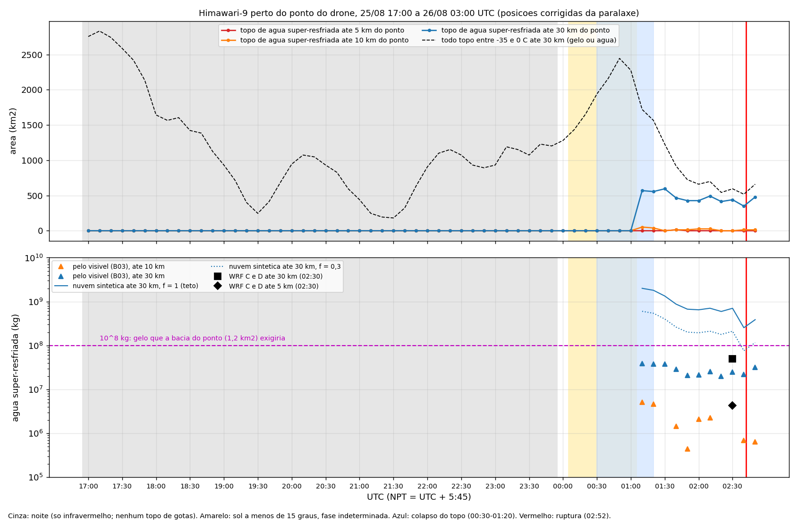
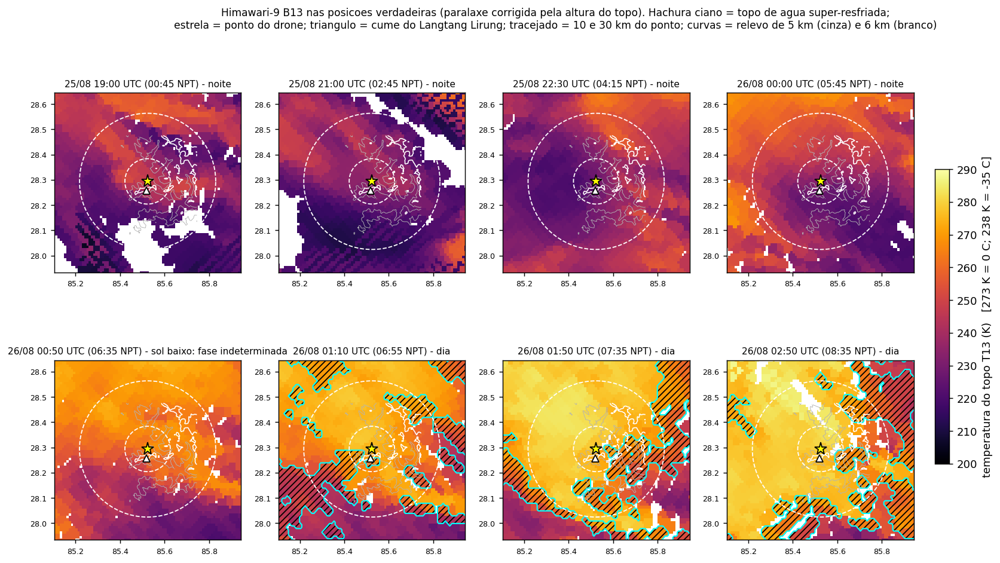

# Água super-resfriada perto do anfiteatro e do ponto do drone: modelos e satélite (29/10/2026)

**Pergunta:** quanta água super-resfriada havia perto do anfiteatro e do ponto do drone na noite de 25 para 26/08/2026, segundo os modelos e segundo as imagens de satélite? É o bastante para a hipótese?

* **Ponto do drone:** 28,293985 N, 85,523964 E. Ver [TESTES_PONTO_DRONE_COLAPSO_NUVEM.md](TESTES_PONTO_DRONE_COLAPSO_NUVEM.md).
* **Massa de referência:** 10⁸ kg de gelo no chão da bacia do ponto (1,19 km²), que é o alcançável por precipitação local.
* **Nível de 0 °C:** 5,78 km (sondagem do ERA5 pré-colapso).

## 1. Modelos (WRF v4.7.1, d03 de 1 km, NSSL 2 momentos)

Massa de água líquida abaixo de 0 °C, de 17:00 a 03:00 UTC. Fontes: `data/processed/wrf_lhende/toro_wrf/agua_sr_*.json` e `criterios_*.json`. Os círculos estão centrados no sítio antigo (28,271 / 85,515), a 2,7 km do ponto do drone.

| Rodada | até ~5 km | até 10 km | até 30 km | gelo até 5 km | granizo e graupel no chão do maciço |
|---|---|---|---|---|---|
| A (controle) | 2 × 10⁴ kg (17:30) | 7 × 10⁴ kg | 6 × 10⁶ kg (22:45) | — | zero |
| B (Estado A) | 2 × 10⁴ kg | 8 × 10⁴ kg | 1,0 × 10⁷ kg (22:45) | 1,7 × 10⁶ kg (00:45) | zero |
| C (B + vórtice) | 4,3 × 10⁶ kg (02:30) | 1,3 × 10⁷ kg (02:30) | 5,0 × 10⁷ kg (02:30) | 1,7 × 10⁶ kg | zero |
| D (C + disparo com w) | 4,3 × 10⁶ kg (02:30) | — | 5,0 × 10⁷ kg (02:30) | 1,7 × 10⁶ kg | zero |

* **Sem o vórtice (A e B),** o modelo quase não tem água super-resfriada perto do anfiteatro: ~10⁴ kg até 10 km. O máximo até 30 km (~10⁷ kg) cai às 22:45, na convecção.
* **Com o vórtice (C e D),** a água super-resfriada cresce até 02:30. O máximo fica 5 vezes acima do de B até 30 km e ~250 vezes até 5 km, mas não congela nem chega ao chão como gelo.
* **Limites do modelo:**
  * o relevo do d03 vai só até 6.438 m, contra 7.216 m no GLO-30;
  * a 1 km, o maciço de 5,6 km do ponto do drone também é suavizado;
  * com o vórtice ligado, uma diferença do tamanho do arredondamento já muda o d02 inteiro em 30 min (ver o módulo toro_wrf 4.1 em `scripts/toro_wrf/LEIA-ME_toro_wrf.md`).

## 2. Satélite (Himawari-9, 25/08 17:00 a 26/08 03:00 UTC, a cada 10 min)

Script: `scripts/himawari/agua_sr_satelite.py`. Saídas: `data/processed/agua_sr_satelite/`.

**Método:**
* **Posição corrigida da paralaxe:** a altura de cada topo vem do B13, pela sondagem. A 66° de zênite, um topo a 8 km aparece ~20 km a WNW.
* **Topo de água super-resfriada:** pixel com 238 K ≤ T13 < 273 K e assinatura de gotas.
  * À noite: B07 − B13 ≤ −2 K.
  * De dia: refletância em 3,9 µm ≥ 0,10 e B05 ≥ 0,25, **e o pixel tem de diferir da manhã de 25/08 na mesma hora** (T13 4 K mais frio, B05 +0,08 ou B03 +0,10).
  * **Por que a diferença é obrigatória:** sem ela, o relevo frio entra como nuvem. Rocha e neve a 5–7 km têm T13 < 273 K e passam nos limiares de fase. Na manhã quase limpa de 25/08, o mesmo classificador marcava 2.161 km² de "água super-resfriada" até 30 km (~10⁸ kg). Uma primeira versão desta análise, sem esse controle, publicou números diurnos contaminados assim; eles foram substituídos pelos abaixo.
  * Com o sol a menos de 15° de altura (00:00–01:00 UTC), a fase fica indeterminada, porque os dois índices explodem.
* **Massa, por dois caminhos:**
  * **pelo visível** (dia): espessura óptica pelo B03 e raio de gota de 10 µm (LWP = ⅔ ρ τ rₑ);
  * **pela "nuvem sintética"** (dia e noite): coluna adiabática de água líquida do nível de 0 °C até o topo observado, LWP = ½ Γ H², com Γ = 1 g m⁻³ km⁻¹. Fator subadiabático f = 1 dá o teto; f ≈ 0,3 é o típico.

Nos mapas, às 22:30 e às 00:00 UTC o núcleo mais frio da convecção (~210–220 K) está sobre o ponto do drone e o Langtang Lirung. Às 00:50 o topo esquentou em toda a área.

**Resultados:**

1. **À noite (17:00–23:50), nenhum topo de água super-resfriada até 30 km.**
   * Os topos entre −35 e 0 °C (180–2.800 km²) têm B07 − B13 de +1 a +15 K (mediana +6 a +11 K). É gelo semitransparente: bordas de bigorna e cirros, não nuvem de gotas.
   * O núcleo da convecção (topos de 200–220 K) é opaco. **O que houvesse de água super-resfriada embaixo ou dentro dele não é visível do satélite.**
2. **00:00–01:00 (colapso da nuvem):** a fase é indeterminada pelos limiares absolutos. A diferença entre os dias contorna o sol baixo, porque a geometria se repete no mesmo horário.
   * Por ela, a mancha sobre o Langtang Lirung tem o B05 0,08–0,25 mais alto que em 25/08 das 00:50 às 03:00. É uma camada de gotas por cima da neve (TESTES § 3c).
   * O T13 dela (258–273 K) é o mesmo da neve no dia 25 (261–269 K): é nuvem baixa colada ao maciço, à temperatura da superfície, abaixo de 0 °C. É água super-resfriada, mas em camada fina.
3. **De 01:10 em diante, topos de água super-resfriada (só pixels que diferem de 25/08):**

| UTC | até 5 km | até 10 km | até 30 km | topo médio (30 km) | massa pelo visível, 10 km | massa pelo visível, 30 km | nuvem sintética, 30 km (f = 1) |
|---|---|---|---|---|---|---|---|
| 01:10 | 0 | 52 km² | 569 km² | 7,9 km | 5,1 × 10⁶ kg | 3,9 × 10⁷ kg | 2,0 × 10⁹ kg |
| 01:30 | 0 | 0 | 595 km² | 7,5 km | — | 3,8 × 10⁷ kg | 1,3 × 10⁹ kg |
| 02:00 | 0 | 26 km² | 427 km² | 7,3 km | 2,1 × 10⁶ kg | 2,2 × 10⁷ kg | 6,5 × 10⁸ kg |
| 02:30 | 0 | 0 | 440 km² | 7,2 km | — | 2,5 × 10⁷ kg | 7,0 × 10⁸ kg |
| 02:50 | 0 | 13 km² | 349 km² | 6,8 km | 7 × 10⁵ kg | 2,2 × 10⁷ kg | 2,5 × 10⁸ kg |

   * As áreas são em múltiplos de um pixel, que tem ~13 km² no chão.
   * Até 5 km do ponto, só um pixel às 01:40 (1,5 × 10⁶ kg).
   * As nuvens até 30 km ficam a NE e a SE. São as que já apareciam a partir das 03:00 na primeira análise de fase.
4. **Às 02:50, na hora da ruptura,** não há água super-resfriada até 5 km do ponto. Até 10 km há ~7 × 10⁵ kg, e até 30 km 2 × 10⁷ kg em nuvens de topo a ~6,8 km.

## 3. Modelo contra satélite

* **Até 30 km, às 02:30:** o satélite dá 2,5 × 10⁷ kg pelo visível, e C e D dão 5,0 × 10⁷ kg. É a mesma ordem de grandeza. A e B ficam abaixo de 10⁷ kg em toda a noite.
* **Até 10 km:** C dá 1,3 × 10⁷ kg às 02:30. O satélite dá no máximo 5 × 10⁶ kg (01:10) e nada às 02:30. Perto do ponto, o modelo com vórtice tem mais água super-resfriada do que o satélite vê.
* **Leitura:** nenhuma das duas fontes mostra mais que ~10⁷ kg a até 10 km do ponto depois do colapso.

## 4. Para a hipótese

### Quanto gelo é preciso: o gatilho não precisa ter a massa da ruptura

A massa de 10⁸ kg usada acima é a que **a bacia do ponto consegue receber** por precipitação local em ~2,5 h. Não é a que **a hipótese exige**.

* **A ruptura foi sobretudo de rocha.** Adhikari et al. escrevem "primarily rocks with smaller portion of ice", e Petley põe a superfície de ruptura em rocha. A rocha vem da encosta, não da nuvem.
* **O que a nuvem teria de fornecer é o gatilho:** a carga e, principalmente, a água de fusão que entra nas fraturas de uma encosta que já estava perto do limite (a geleira suspensa vinha acelerando, segundo Wang et al. 2026).
* **Para uma encosta no limite, o gatilho pode ser pequeno.** São 10⁶–10⁷ kg de gelo, isto é, 10³–10⁴ m³ de água de fusão, de 1 a 10 mm sobre a bacia de 1,2 km². Nessa faixa, a água super-resfriada vista até 10 km do ponto (≤ 5 × 10⁶ kg depois das 01:10) e a do WRF C (1,3 × 10⁷ kg) **deixam de ser insuficientes**.
* **O volume total também não precisa ser 10⁸ m³.** Esse valor de Adhikari et al. vem de uma calibração empírica entre amplitude sísmica e volume feita com deslizamentos da costa do Alasca (Karasözen & West 2024). Os autores dizem que ela é "highly uncertain because the empirical calibration is based on substantially smaller landslides from a different region". As nossas estimativas independentes (área do depósito, área da fonte, perda de geleira) apontam para ~10⁷ m³.

| | Massa | Comparada com o que a bacia recebe (~10⁸ kg) e com um gatilho (10⁶–10⁷ kg) |
|---|---|---|
| Água super-resfriada visível até 10 km, 01:10–02:50 | ≤ 5 × 10⁶ kg | 20 vezes menos que 10⁸; na faixa de um gatilho |
| Idem até 30 km | 2–4 × 10⁷ kg | abaixo de 10⁸ mesmo se toda convergisse; acima de um gatilho |
| WRF C e D, até 30 km (até 10 km) | 5 × 10⁷ kg (1,3 × 10⁷ kg) | metade de 10⁸; acima de um gatilho |
| Teto teórico escondido sob a bigorna, até 10 km, 22:00–00:30 | 0,7–2,5 × 10⁹ kg | acima |

* **Depois do colapso (01:10–02:50),** a água super-resfriada visível não forma 10⁸ kg de gelo na bacia do ponto, mas está na faixa de um gatilho.
* **O satélite não exclui o reservatório de antes do colapso.**
  * Das 22:00 às 00:30 o núcleo convectivo é opaco, e o que estivesse dentro dele não se vê.
  * O teto vem da nuvem sintética: coluna adiabática do 0 °C (5,8 km) até −35 °C (~9,8 km), com f de 0,3 a 1, sobre 314 km². Dá 0,7–2,5 × 10⁹ kg de água líquida até 10 km.
  * É um teto físico, não uma estimativa: nuvens convectivas profundas congelam bem antes de −35 °C.
* **O teste que resta é de modelo, não de satélite.**
  * É a rodada E, com o vórtice recentrado no ponto do drone, e o d04 de 333 m.
  * Ela precisa depositar gelo na bacia do ponto entre 22:00 e 02:45: pelo menos 10⁶–10⁷ kg para a hipótese do gatilho e até ~10⁸ kg para a de carga.
  * Só assim fecha com o que o satélite mostra depois.
