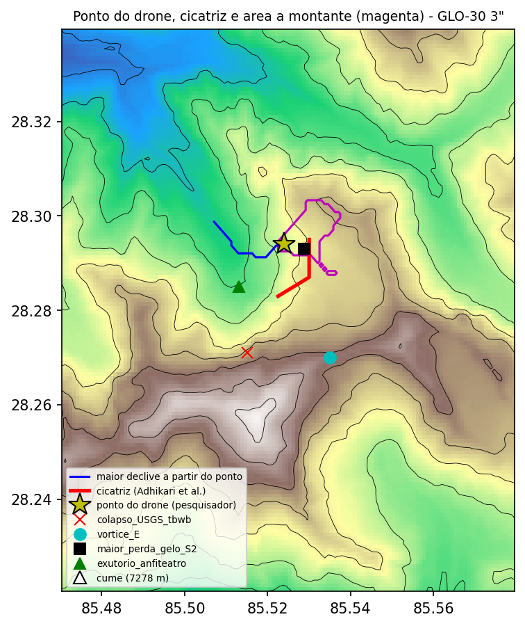

# Testes do colapso de nuvem no ponto do drone (24/10/2026)

**Ponto indicado pelo pesquisador:** 28,293985 N, 85,523964 E. É o lugar que o drone de Hei Mu vê no instante do colapso e onde o granizo teria se acumulado primeiro.

**Pergunta:** antes de qualquer simulação, um colapso de nuvem que acumule granizo nesse ponto é compatível com o que sabemos?

Scripts:
* `scripts/neve_anfiteatro/ponto_drone.py` (relevo GLO-30 a 3″);
* `scripts/himawari/fase_topo_10min.py <bruto> <saída> 28.293985,85.523964 ponto_drone`.

Saídas em `data/processed/ponto_drone/` e `data/processed/himawari_fase_topo/fase_topo_ponto_drone_10min.*`.

## 1. Relevo: onde fica o ponto

* **Cota e encosta:** 4.638 m, numa encosta de 30° voltada para W (261°). Até 300 m em volta, o relevo chega a 4.955 m.
* **Fica em cima da ruptura mapeada:**
  * a 0,37 km do ponto de Petley (28,2921 / 85,5271; coroa a ~5.140 m, base a ~3.990 m);
  * a 0,6 km do extremo NE da cicatriz de Adhikari et al.;
  * a 0,49 km da maior mancha de perda de gelo do Sentinel-2 (2,4 ha, a 5.070 m).
* **Fica longe dos pontos que usamos até agora:**
  * 2,7 km do "ponto de colapso" do USGS (28,271 / 85,515), que usamos até agora como sítio no Himawari, no WRF e no CM1;
  * 2,9 km do centro do vórtice do experimento E (28,270 / 85,535, a 6.106 m).
  * Você tem razão: os dois estavam no lugar errado.
* **Não fica no anfiteatro do Langtang Lirung.** O ponto e a cicatriz ficam num maciço mais baixo, ao norte, separado do Langtang Lirung (7,2 km) pelo vale cujo exutório está a 4.000 m (28,285 / 85,513).
* **Área a montante do ponto** (D8; magenta no mapa):
  * 1,19 km², de 4.500 a 5.634 m, mediana 5.154 m;
  * **nada acima de 6.000 m**;
  * contém a mancha de perda de gelo do S2, o ponto de Petley e o extremo NE da cicatriz.
* **Consequência:** o que se acumulou no ponto não pode ter escorregado das encostas de 6–7 km do Langtang Lirung, que drenam para o anfiteatro, a oeste. Se o granizo "se formou mais alto", foi mais alto **na nuvem**, não no relevo. Caiu, ou escorregou no máximo ~1 km de desnível, dentro dessa bacia de 1,2 km².
* **Para onde escorre:** a partir do ponto, o maior declive desce para W e NW até o vale, a 3.620 m, em 2,2 km.

## 2. Termodinâmica (sondagens do ERA5 usadas no CM1)

| Sondagem | T a 4.638 m | T a 5.634 m (topo da bacia) | 0 °C | −3 °C | −8 °C |
|---|---|---|---|---|---|
| pré (25/08) | +5,9 °C | +1,4 °C | 5.945 m | ~6.620 m | 7.575 m |
| pré-colapso | +5,5 °C | +0,7 °C | 5.776 m | ~6.380 m | 7.288 m |
| pico | +4,9 °C | +0,4 °C | 5.716 m | ~6.380 m | 7.353 m |

* **A bacia inteira fica acima de 0 °C.** O granizo tem de nascer na nuvem, entre −3 e −8 °C (6,4–7,6 km), e atravessar 0,1–1,3 km de ar a +0–6 °C antes de tocar o chão. Granizo grande sobrevive a isso; graupel e neve chegam parcialmente fundidos.
* **O que se acumula nessa cota derrete.** A neve úmida e o granizo acumulados a 4,6–5,6 km viram água de fusão. O efeito sobre a encosta deixa de ser só carga: passa a ser água entrando nas fraturas da rocha.
* **Água precipitável acima do ponto:** 10–11 mm (acima de 4.322 m, 12,5–14 mm).

## 3. Himawari-9 sobre o ponto (B13 e B07, 2 km, paralaxe corrigida)

* **22:00–00:30 UTC: topos frios sobre o ponto,** 219–239 K (≈ −54 a −34 °C, topos de ~10–12 km), para qualquer hipótese de altura. É convecção profunda.
* **00:30–01:20: o topo esquenta** de ~235 K para ~270–276 K (desce para perto de 0 °C ou abaixo).
* **02:00–02:50: nada frio sobre o ponto.** Aos 02:50 o B13 dá 277–279 K para topos de 8–12 km, isto é, nuvem baixa e quente ou chão. Isso combina com o mar de nuvens a ~4–4,5 km do vídeo do drone: o ponto, a 4.638 m, fica logo acima do topo dessa camada.
* **A resolução não separa os dois pontos.** A série é praticamente igual à do sítio antigo: o pixel do B13 tem 2 km e os dois pontos estão a 2,7 km. Pelo IR não dá para dizer se o núcleo que colapsou estava sobre o ponto ou sobre o anfiteatro. Só o visível B03 (500 m) separa os dois, e só a partir de ~00:10 UTC, quando já é dia.
* **Intervalo:** do fim dos topos frios (00:30–01:20) até a ruptura (02:52:16) vão 1,5–2,5 h. O precursor ML 2,5 cai às 02:35.

## 4. Balanço de massa na bacia do ponto (1,19 km²)

1 mm de água equivalente sobre a bacia = 1,19 × 10⁶ kg.

| Massa sólida M | Água equivalente sobre a bacia | Comparação |
|---|---|---|
| 1,3 × 10⁷ kg | 11 mm | todo o vapor da coluna acima da bacia |
| 10⁸ kg | 84 mm | tempestade forte: 30–60 mm/h durante 1,5–3 h sobre a bacia |
| 10⁹ kg | 840 mm | acima de recordes mundiais de chuva em poucas horas |
| 10¹⁰ kg | 8,4 m | impossível como precipitação local |

* **O que é alcançável:** com os topos frios durando ~2,5 h (22:00–00:30), um núcleo que ficasse parado sobre a bacia dá **~1–2 × 10⁸ kg**. A 1/10 da densidade do gelo (~90 kg/m³), isso ocupa ~1–2 × 10⁶ m³, cerca de 10–20 % do volume da ruptura (~10⁷ m³).
* **O critério do E não serve para esta bacia.** O critério pré-registrado era de 10⁹–10¹⁰ kg, contado nas encostas ≥ 6 km. Precisa ser refeito para a bacia do ponto: candidato com ≥ 10⁸ kg no solo entre 22:00 e 02:45.
* **Para ir além de ~10⁸ kg,** a nuvem teria de despejar sobre 1,2 km² a água de uma área de ~10–50 km², isto é, o colapso concentrado da hipótese. Não há como verificar isso por satélite a 2 km.

## 5. Resultado dos testes

| Teste | Resultado | Situação |
|---|---|---|
| 1. Relevo | O ponto fica sobre a ruptura. A bacia vai só até 5,6 km. | Exclui a fonte nas encostas de 6–7 km do Langtang Lirung; o granizo viria da nuvem |
| 2. Termodinâmica | Bacia inteira a +0–6 °C; granizo nasce a 6,4–7,6 km | Possível, com fusão parcial e água de fusão |
| 3. Himawari | Convecção profunda sobre o ponto até 00:30; colapso 00:30–01:20; sem nuvem fria às 02:50 | Compatível no tempo (atraso de 1,5–2,5 h); o IR a 2 km não localiza o núcleo |
| 4. Massa | ~10⁸ kg é alcançável; 10⁹ exige concentração de 10–50×; 10¹⁰ fica excluído | Possível só como carga mais água; não como fonte da maior parte do volume |

## 6. Próximos testes antes de simular

1. **Visível B03 (500 m), de 00:00 a 03:00 UTC.** Onde estava o núcleo em relação ao ponto, se houve sombra de nuvem sobre a bacia e onde estava o mar de nuvens às 02:50. É o único dado que separa o ponto do anfiteatro. Requer baixar as imagens.
2. **Diferença B07 − B13 à noite (17:00–23:50 UTC)** para nevoeiro e nuvem baixa no vale.
3. **Visada do drone.** Com a posição e a altura do drone (se houver alguma pista nas fontes chinesas), conferir se o ponto e a encosta acima dele estavam à vista.
4. **WRF.** Só depois desses testes: vórtice do E recentrado no ponto, critério de massa refeito para a bacia de 1,2 km² e d04, porque a 1 km esse maciço de 5,6 km também é suavizado.
