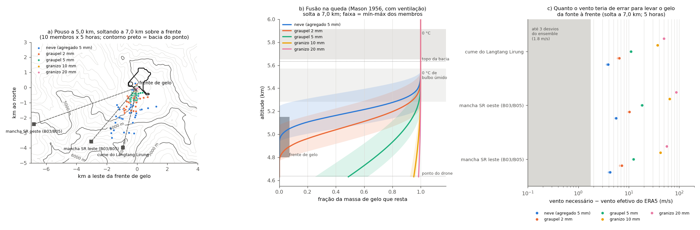

# Transporte do gelo até a frente de gelo, com o erro do ERA5 medido pelo ensemble (30/10/2026)

**Pergunta do pesquisador:** como o gelo da nuvem poderia chegar à frente de gelo do quadro do Xinhua usando os erros do ERA5 ou mecanismos físicos desconhecidos?

**Alvo:** a frente de gelo, 28,2918 N / 85,5284 E, a 4,8–5,15 km (`TESTES_PONTO_DRONE_COLAPSO_NUVEM.md`, § 7). Os cálculos usam 5,0 km como cota de pouso.

**Dados:**
* ERA5 em ensemble (EDA): 10 membros mais o spread, 0,5°, de 3 em 3 h, u v t q w de 600 a 300 hPa, mais tcwv, cape, tp e cp. Baixado pelo vlab em 29/10 para `vlab_cache/Himalaia_2026/saida/era5_ens/`; os SHA-256 estão no `LEIA_era5_ens.txt`.
* ERA5 determinístico horário a 0,25° (`entrada/era5_wrf/era5_wrf_pl_*.grib`, o mesmo do WRF), para o geopotencial a 600 hPa e para o CAPE com o perfil completo.

**Script:** `scripts/transporte_gelo/transporte_era5_ens.py <dir_era5_ens> <dir_era5_wrf>`. Saídas em `data/processed/transporte_gelo/` (`transporte_era5_ens.json`, `.txt` e `.png`).

**Método, por membro e para as horas 22:00, 23:00, 00:00, 00:30 e 01:00 UTC** (interpoladas no tempo entre 21, 00 e 03 UTC):
* **Alturas:** o z de 600 hPa vem do determinístico; daí para cima, hipsometria com o Tv do membro.
* **Partículas soltas a 6,4, 7,0, 7,6 e 9,0 km:**
  * neve (agregado de 5 mm, 1 m/s);
  * graupel de 2 e 5 mm (Locatelli e Hobbs 1974);
  * granizo de 10 e 20 mm (arrasto com Cd = 0,6 e 850 kg/m³).
  * A velocidade é corrigida pela densidade do ar.
* **Queda:** é integrada a cada 10 m com o vento do membro. A fusão segue Mason (1956), com ventilação, condução e evaporação; o diâmetro diminui à medida que o gelo derrete.

## 1. O erro do ERA5 medido pelo ensemble é pequeno ali

| No alvo, 22:00–01:00 UTC | Média dos membros | Spread do ensemble |
|---|---|---|
| Vento a 500 hPa | < 1,5 m/s | 0,5–0,8 m/s por componente |
| Vento a 400–300 hPa | 3–5 m/s de ENE | 0,5–1,1 m/s |
| Temperatura | — | 0,1–0,4 K |
| 0 °C | 5.802 m (5.650–5.915 entre membros e horas) | — |
| 0 °C de bulbo úmido | 5.393 m (5.282–5.570) | — |
| Vento médio entre 5,0 km e o 0 °C | 0,8 m/s (0,1–2,0) | — |

A média do ensemble bate com o determinístico, com diferenças de décimos de m/s e de K. **Pelo ensemble, o ERA5 tem confiança no vento fraco e na camada quente.** Nenhum membro põe o 0 °C na bacia, que vai de 4,5 a 5,63 km.

## 2. Deriva na queda: o vento do ERA5 não atrapalha, mas também não traz gelo de longe

**Gelo solto a 7,0 km sobre a frente** (pouso a 5,0 km; 10 membros × 5 horas):

| Partícula | Distância do pouso | Pousa a até 1 km |
|---|---|---|
| granizo 10–20 mm | 0,09–0,12 km (máx. 0,3) | 100 % |
| graupel 5 mm | 0,44 km (máx. 1,0) | 98 % |
| graupel 2 mm | 0,82 km (máx. 1,9) | 72 % |
| neve | 1,6 km (máx. 3,7) | 26 % |

* **Com o vento do próprio ERA5, uma célula sobre a frente põe o gelo na frente.** Não é preciso erro nenhum. O vento efetivo da queda é de 0,8–1,4 m/s, e o desvio do ensemble é de ~0,6 m/s.
* **A condição é a célula estar sobre a frente.** O Himawari põe o núcleo mais frio sobre o ponto às 22:30 e às 00:00, dentro da precisão de um pixel de 2 km. Esse é o lugar do vórtice do E2.

**Gelo vindo de outras fontes.** A tabela dá quanto o vento teria de diferir do ERA5 para trazer o gelo até a frente (gelo solto a 6,4–7,6 km):

| Fonte | Distância e rumo até a frente | Neve | Graupel 2 mm | Graupel 5 mm | Granizo 10–20 mm |
|---|---|---|---|---|---|
| Mancha de água super-resfriada E (B03/B05, 6,3–6,9 km) | 4,7 km para NE | 3,8–5,1 m/s (6–8 σ) | 6–9 m/s (10–14 σ) | 10–17 m/s | 33–79 m/s |
| Mancha W (5,0–5,5 km) | 7,2 km para ENE | 4,9–7,2 m/s | 8–13 m/s | 15–25 m/s | 49–121 m/s |
| Cume do Langtang Lirung | 4,1 km para NNE | 3,5–4,7 m/s | 5–8 m/s | 9–15 m/s | 29–69 m/s |

* **O granizo dessas fontes fica excluído.** Ele cai depressa demais para viajar 4–7,2 km.
* **Neve e graupel pequeno precisariam de 4–9 m/s de SW ou S** na camada de 5–7,6 km. O ERA5 tem ~1 m/s de NE, com desvio de 0,6 m/s, o que dá 6–14 desvios do ensemble.
  * Isso não é erro do ERA5 em escala sinótica. Seria um escoamento da própria convecção ou da montanha (corrente de saída, vento canalizado), que a grade de 0,5° não tem e que o ensemble não amostra.
  * Essas manchas são também nuvem de gotas. Antes de cair, a água teria de congelar.

## 3. Fusão: o granizo chega intacto; o graupel pequeno precisa de um mecanismo conhecido

Fração da massa que resta, solta a 7,0 km (média dos membros):

| Partícula | 5,63 km (topo da bacia) | 5,0 km (frente) | 4,64 km (ponto do drone) |
|---|---|---|---|
| granizo 20 mm | 1,00 | 1,00 | 0,99 |
| granizo 10 mm | 1,00 | 0,99 | 0,95 |
| graupel 5 mm | 1,00 | 0,85 | 0,49 |
| graupel 2 mm | 1,00 | 0,29 | 0,00 |
| neve | 1,00 | 0,02 | 0,00 |

* **A fusão só começa abaixo do 0 °C de bulbo úmido (~5,4 km).** Com umidade de 70–80 %, a evaporação resfria a partícula, e por isso o gelo atravessa intacto os primeiros ~400 m abaixo do 0 °C.
* **O mecanismo da camada isotérmica:**
  * O gelo que derrete retira calor do ar.
  * **3,0 mm** de gelo derretido (2,4–3,7 entre membros) bastam para levar a 0 °C toda a camada entre 5,0 km e o 0 °C. Até o ponto do drone (4,64 km), são 6,5 mm.
  * Depois disso, a neve e o graupel chegam à frente de gelo sem derreter.
  * **O vento fraco do ERA5 ajuda.** Com 0,8 m/s, o ar quente leva ~40 min para atravessar uma célula de 2 km. Para manter a camada fria contra essa renovação, basta derreter ~4 mm/h (3 mm × 0,8 m/s / 2 km).
  * É um processo conhecido, o mesmo que faz nevar abaixo do 0 °C previsto sob precipitação forte. O ERA5 não o resolve numa célula de poucos km.
* **Consequência para o gatilho (1–10 mm de água de fusão na bacia):**
  * os primeiros ~3 mm derretem no ar e resfriam a camada;
  * o que vem depois deposita gelo na frente;
  * o granizo e o graupel grande nem precisam disso.

## 4. Massa: o que falta no ERA5 é a própria célula

* **Precipitação dos membros, 21–03 UTC:**
  * no alvo, 0,03–0,32 mm;
  * no máximo dos 4 nós vizinhos, 0,04–0,99 mm.
  * Isso dá **3 × 10⁴ a 4 × 10⁵ kg na bacia**: 3–30 vezes menos que o gatilho mínimo (10⁶ kg) e 300–3.000 vezes menos que o teto de ~10⁸ kg.
* **Ambiente do ERA5 sobre o alvo, em todos os membros:**
  * CAPE de superfície às 00 UTC de 0,1–1,3 J/kg;
  * CAPE nulo para parcelas de 600, 550 e 500 hPa no determinístico;
  * subsidência a 500 hPa (ω = +0,06 a +0,10 Pa/s);
  * divergência de +3 a +5 × 10⁻⁶ s⁻¹ entre 600 e 450 hPa.
  * **O ERA5 não tem célula ali,** e o Himawari tem topos de 219–239 K sobre o ponto de 22:00 a 00:30.
  * **Esse é o erro do ERA5 que importa, e o ensemble não o mede.** Os membros compartilham o modelo, a convecção parametrizada e o relevo de 0,5°, e por isso erram juntos.
* **Quanto o perfil teria de errar:**
  * Uma parcela de 600 hPa só alcança CAPE ≥ 50 J/kg com **+3,0 a +3,25 K** (mantendo a UR), ≈ 10 vezes o spread da temperatura (0,25–0,35 K). Para 250 J/kg são +4,0 a +4,25 K.
  * Só umedecer não basta: saturada, a parcela dá 7–25 J/kg.
* **Onde o próprio ERA5 tem instabilidade:**
  * no nó 28 N / 85 E, a ~60 km a WSW, sobre o relevo mais baixo ao sul da cordilheira: 106 J/kg às 21 UTC e 200 J/kg às 18 UTC (média dos membros);
  * no extremo SW do recorte, 280–530 J/kg;
  * às 00 UTC já não há instabilidade em nenhum ponto.
  * Ar desses vales subindo pela encosta sul, para dentro do maciço, é um caminho que a grade de 0,5° não representa.
* **O que uma célula precisaria fazer** (2,5 h, eficiência 0,3, chuva uniforme na célula):

| Massa na bacia | Chuva na célula | Entrada radial (célula de 2–5 km) | Convergência | Ascensão na base |
|---|---|---|---|---|
| 10⁶ kg | 0,8 mm | 0,03–0,09 m/s | 3 × 10⁻⁵ s⁻¹ | 0,07 m/s |
| 10⁷ kg | 8,4 mm | 0,3–0,9 m/s | 3 × 10⁻⁴ s⁻¹ | 0,65 m/s |
| 10⁸ kg | 84 mm | 3,4–8,5 m/s | 3 × 10⁻³ s⁻¹ | 6,5 m/s |

* O gatilho (10⁶–10⁷ kg) pede uma célula comum, com ascensão abaixo de 1 m/s. Só o teto de 10⁸ kg pede uma célula forte.
* A dificuldade não está no tamanho da célula. Está em ela existir num perfil que o ERA5 dá como estável e em subsidência.

## 5. Conclusão

1. **O transporte não é o gargalo.** O vento do ERA5 é fraco (≤ 1,5 m/s abaixo de 7,6 km) e o ensemble tem confiança nele. Com ele, o gelo que cai de uma célula sobre a frente fica na frente: o granizo a menos de 0,3 km, o graupel a menos de 1–2 km.
2. **O gelo tem de nascer sobre a frente.**
   * A mancha super-resfriada do Langtang Lirung e o cume ficam excluídos para o granizo.
   * Para neve e graupel, essas fontes exigiriam um vento convectivo de 4–9 m/s contra o ERA5.
   * Isso favorece a configuração E2, com o vórtice na frente de gelo, e não o centro antigo.
3. **A fusão não impede.**
   * Granizo e graupel de 5 mm chegam à frente com 85–100 % da massa.
   * Para neve e graupel pequeno, os primeiros ~3 mm derretidos tornam a camada isotérmica, e daí em diante o gelo chega. Isso é física conhecida, não mecanismo novo.
4. **O erro do ERA5 que a hipótese exige é outro: a célula que falta.**
   * Os 10 membros põem CAPE zero, subsidência e menos de 1 mm de chuva sobre o alvo, onde o Himawari viu convecção profunda.
   * O ensemble não mede esse erro, porque todos os membros usam a mesma física e o mesmo relevo suavizado.
   * Para a célula aparecer seria preciso +3 K a 600 hPa (≈ 10 σ do ensemble) ou ar instável vindo dos vales ao sul, onde o próprio ERA5 tinha 100–280 J/kg às 21 UTC.
   * Se há um "mecanismo desconhecido", ele está na existência da célula e na microfísica (gelo em vez de chuva, a parte da hipótese do toró). Não está no transporte.
5. **O que o WRF E2 com o d04 precisa mostrar:**
   * uma célula sobre a frente entre 22:00 e 00:30, apesar do ERA5;
   * gelo no chão da bacia e da geleira acima de 10⁶ kg;
   * se houver neve ou graupel pequeno, o 0 °C abaixado para perto de 5 km sob a precipitação.

## Limitações

* **O ensemble subestima o erro.** A EDA tem 0,5° e 3 h, e o spread não inclui o erro comum do modelo: a convecção parametrizada e o relevo de 0,5°, que põe a superfície do modelo bem abaixo do maciço (t2m de ~10 °C no nó).
* **Só a queda livre.** As partículas são soltas paradas na altura de partida. O crescimento dentro da nuvem, as correntes ascendentes e o movimento da célula não entram, nem o escorregamento no chão, que pode levar o gelo para o talvegue.
* **Fusão simplificada:** esferas de densidade fixa (graupel 400 kg/m³, granizo 850 kg/m³), sem desprendimento de água e sem a realimentação do resfriamento sobre o perfil. A camada isotérmica é só um balanço de energia.
* **Perfis só de 600 a 300 hPa** (4,4–9,8 km). O CAPE por perturbação usa o determinístico no alvo.
